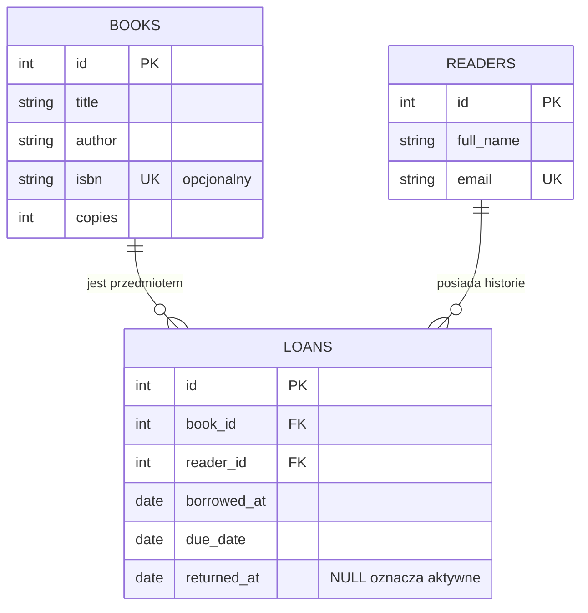

# Diagram ERD

### Ograniczenia

- `books.isbn` jest unikalny, ale może być pusty (`NULL`).
- `readers.email` jest wymagany i unikalny.
- `loans.book_id` wskazuje na `books.id`, a `loans.reader_id` na `readers.id`.
- Aktywne wypożyczenie identyfikuje `returned_at IS NULL`.
- Liczba aktywnych rekordów `loans` dla książki nie może przekraczać `books.copies` (reguła egzekwowana przez API).
